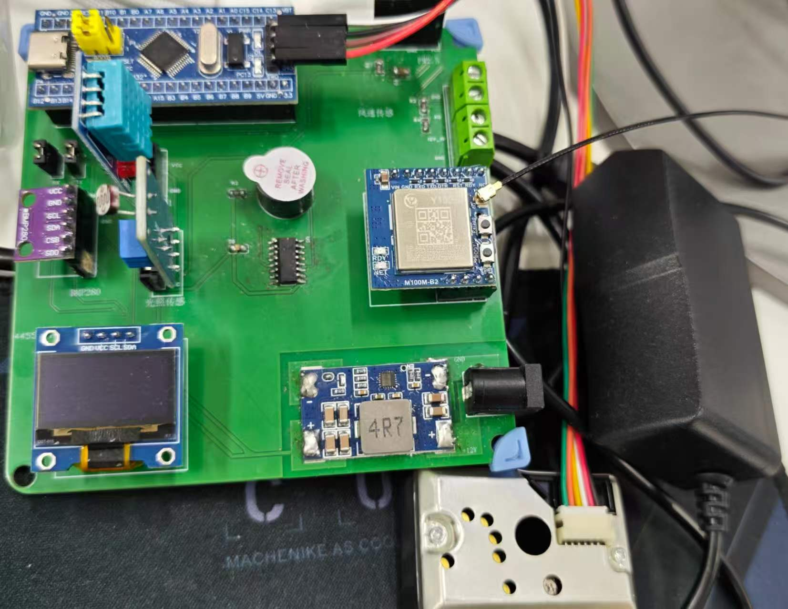
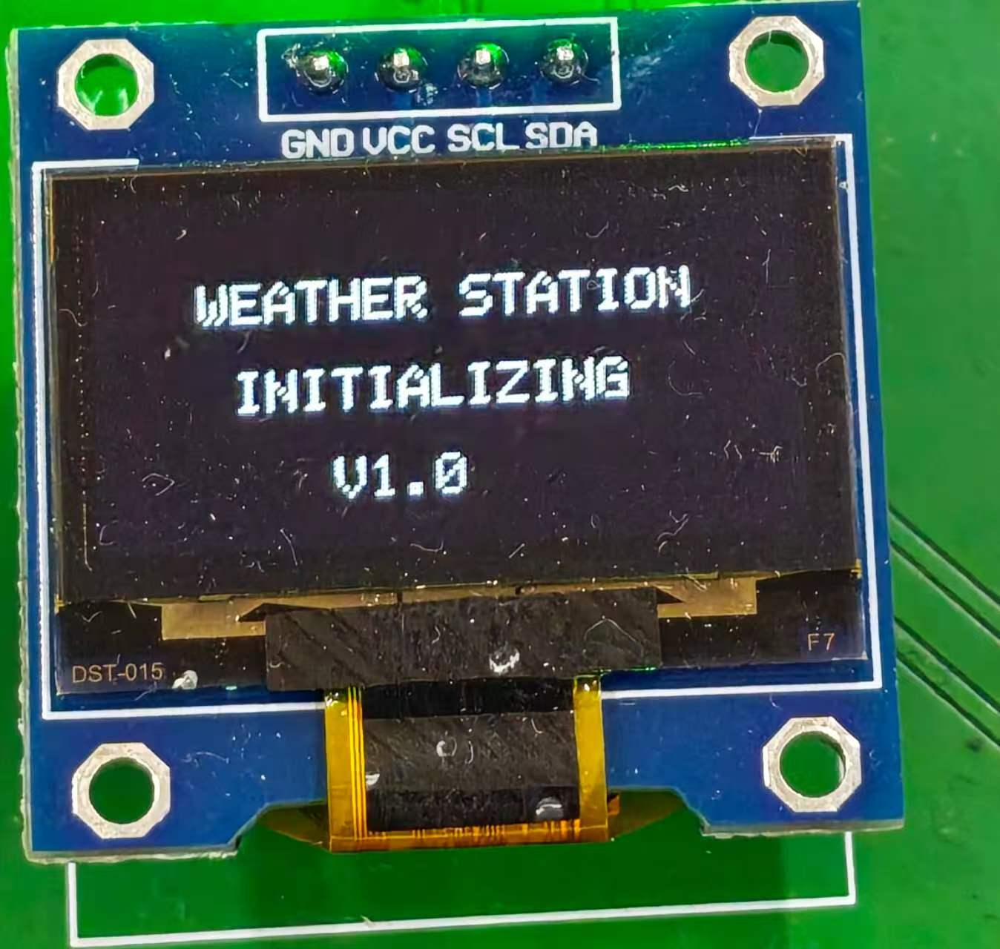
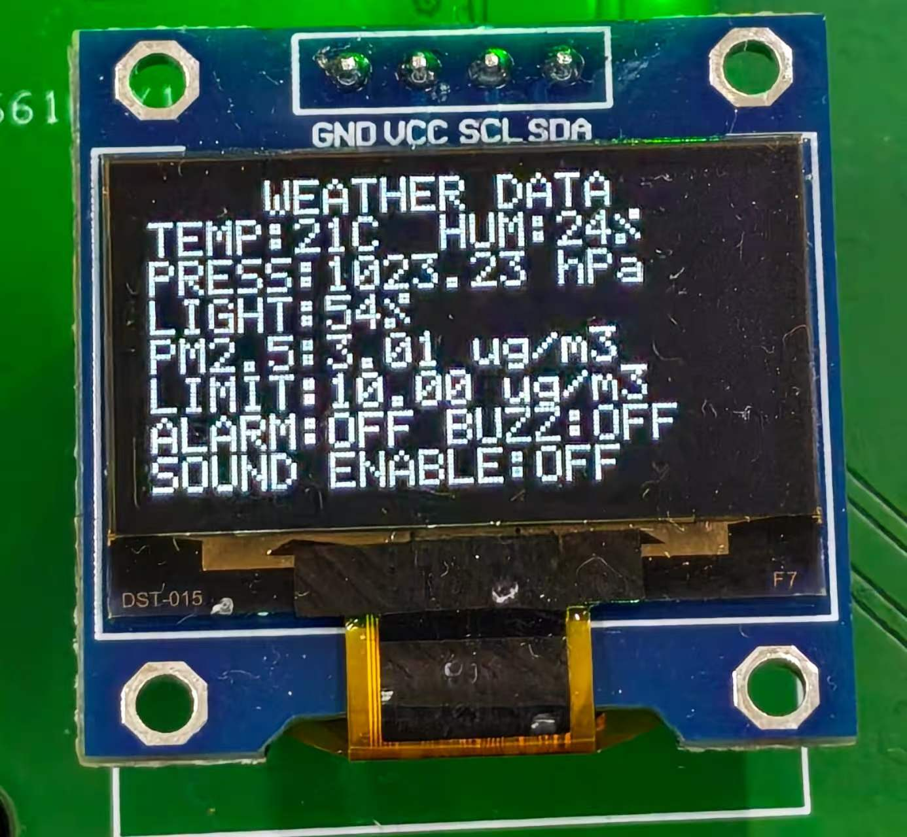
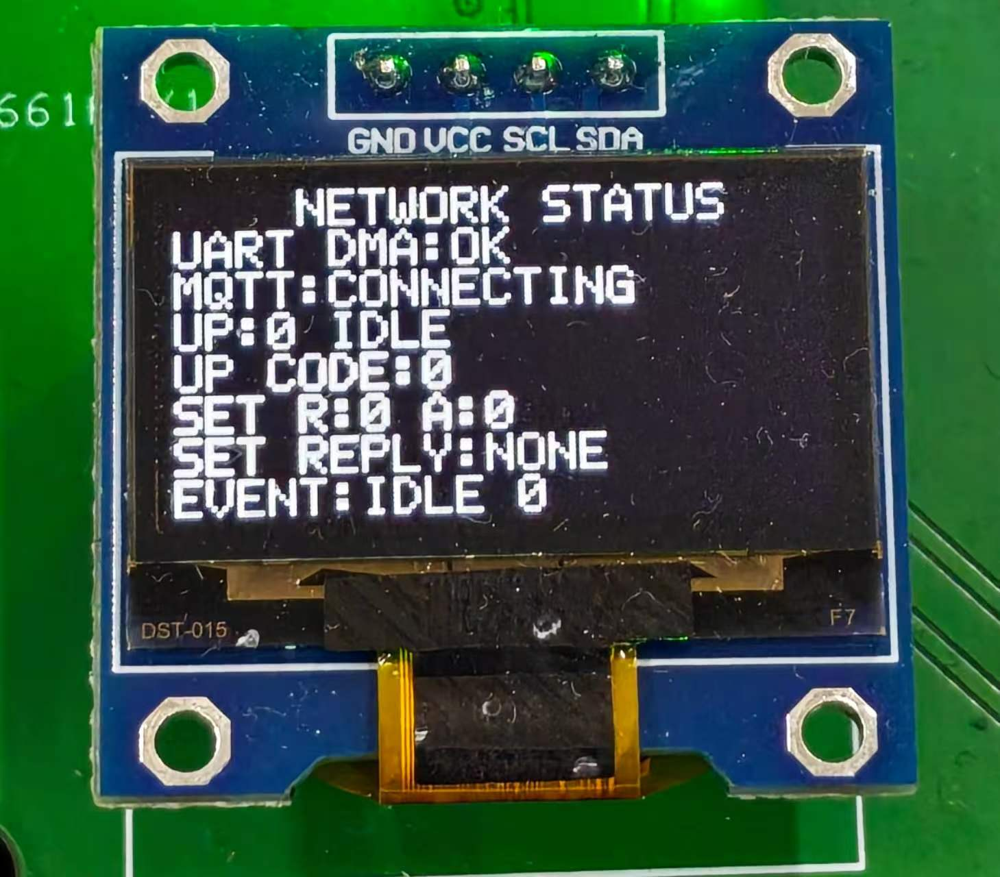
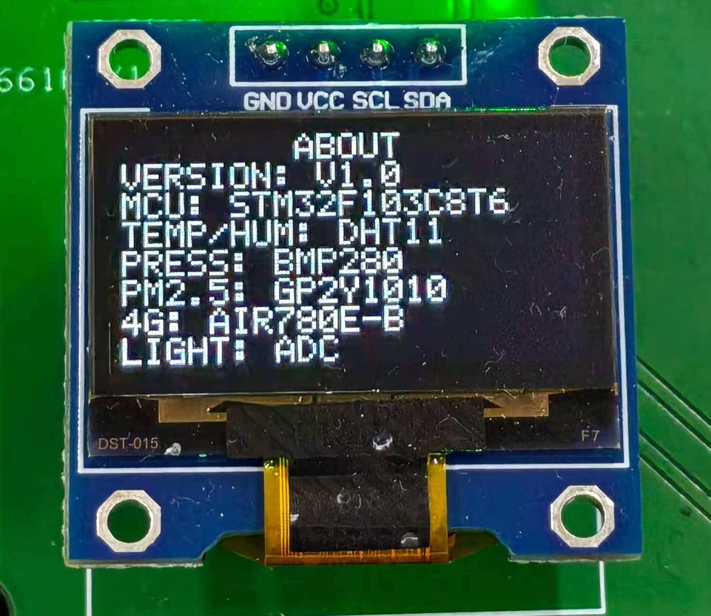

# FreeRTOS 气象站

> STM32F103C8T6 + FreeRTOS + Air780E-B + OneNET｜基于本人裸机气象站的重构项目

本项目在原有裸机气象站的基础上，使用 STM32CubeMX、HAL 和 FreeRTOS 重新组织采集、显示和网络业务。设备读取温湿度、气压、光照和粉尘估算值，显示在 OLED 上，并通过 4G 将数据上传至 OneNET。平台可设置 PM2.5 报警阈值和蜂鸣器声音开关。

## 🔄 裸机版与 FreeRTOS 重构对比

以下对比基于本人本机 `CODE_STM32` 原始裸机工程和当前 FreeRTOS 工程。它描述的是两个具体版本的实现，裸机也可以通过状态机、中断和缓冲区实现类似机制。

| 方面 | 原裸机工程 | 当前 FreeRTOS 工程 | 带来的变化 |
| --- | --- | --- | --- |
| 业务组织 | `main()` 的 `while(1)` 中顺序处理显示、采集、报警和定时上报 | 划分 `Sensor`、`Display` 和 `NetworkTask`，分别负责采集、显示和网络 | 职责更清晰；等待中的任务可让其他就绪任务运行 |
| 计时与调度 | SysTick 更新计数变量，主循环判断 `t1 >= 100` 和 `t >= 2000` 等条件 | 内核按 1 ms 节拍调度；任务使用 `vTaskDelay()`、`vTaskDelayUntil()` 和通知等待 | 等待和唤醒由内核管理，更容易分别调整业务节奏 |
| 网络异常 | `esp8266_init()` 在进入主循环前执行，部分 `while(check_OK == 0)` 没有超时 | 网络任务独立运行，AT 命令限时等待；出错后重同步、等待并重试 | 模块无应答时不必一直卡在启动等待，本地任务仍可调度 |
| 串口接收 | USART1 接收中断逐字节保存，空闲中断调用回调处理文本、下发解析和回复 | USART1 使用循环 DMA 接收；中断记录事件并通知网络任务，在任务中拼行和解析 | 缩小中断中的处理范围，网络业务集中在一个任务中 |
| 数据与共享总线 | 主要通过全局变量在主循环和串口回调之间传递数据 | 用队列传递采集快照、报警配置和事件；OLED 与 BMP280 使用 I²C 互斥锁 | 显示与网络分别取得最新数据，访问共享总线时有明确的保护机制 |
| 单传感器异常 | DHT11 读取返回值未用于判断；光照更新还受 BMP280 读数条件影响 | 为传感器记录有效标志，仅将本轮有效字段加入属性报文 | DHT11 或 BMP280 读取失败时，其他有效字段仍有机会上报 |
| 上传结果 | 通过通用 `OK` 标志等待模块；回调遇到 `post_reply` 后直接返回 | 区分模块 AT 回复和 OneNET 回执，按主题、消息 ID、返回码判断上传结果 | OLED 可显示等待、成功、失败和超时，便于定位通信问题 |
| 报警业务 | 按风速或 PM2.5 阈值驱动蜂鸣器，也可接收阈值设置 | 当前只对 PM2.5 判断；支持云端声音允许开关和超限事件队列 | 增加了静音控制与事件上报；**风速采集和报警暂未移植** |
| 资源占用 | 不包含 FreeRTOS 任务栈和内核堆 | 为任务分配独立栈，配置 10 KiB FreeRTOS 堆，并观察栈、堆历史最小余量 | 内存使用更易观察，同时需要为内核、任务栈和同步对象预留 SRAM |

### 具体例子：4G 模块无应答

- **裸机版：** 上电后先调用 `esp8266_init()`。如果相应的 `OK` 没有到达，代码可能停在无超时的等待中，无法继续进入主循环。
- **重构版：** `NetworkTask` 对 AT 等待设置时限并在失败后重试；`Sensor` 和 `Display` 是独立任务。在断电移除模块的测试中，用户反馈 OLED 表现符合预期，网络重试计数继续增加。

任务隔离来自 FreeRTOS 的调度与任务划分；**超时、重试、DMA 接收、有效性判断和回执解析是本次另外编写的业务与驱动逻辑**，不会因加入 FreeRTOS 自动获得。具体故障测试结果见 [可靠性测试记录](docs/可靠性测试.md)。

两版采样及上传周期不同：裸机版使用 `t1 >= 100` 和 `t >= 2000` 作为主循环条件；当前版正常采集一轮约 3.2 秒加其他开销，联网后约每 10 秒尝试一次属性上报。这些是配置和流程的差别，不构成速度、CPU 占用或实时性的对比测试。

---

## 📸 实物展示

### 设备实物

### OLED 页面

| 启动页 | 传感器数据页 |
| --- | --- |
|  |  |
| **网络状态页（连接中）** | **关于页** |
|  |  |

---

## ✨ 主要功能

| 功能 | 实现 |
| --- | --- |
| 温湿度采集 | DHT11，单总线 GPIO |
| 气压采集 | BMP280，软件 I²C |
| 光照采集 | 光敏电阻式模拟模块，具体型号待确认；ADC 采样并换算相对百分比 |
| 粉尘采集 | GP2Y1010 系列（此前提供型号 GP2Y1010AU0F），ADC 脉冲采样并用旧公式估算 |
| OLED 显示 | 启动页、数据页、网络状态页和关于页；后三页自动轮转 |
| 云端通信 | Air780E-B AT 固件通过 USART1 接入 OneNET MQTT |
| 属性上报 | 上报传感器读数、阈值及报警状态，解析平台回复 |
| 云端控制 | 下发 PM2.5 阈值和蜂鸣器声音开关，设备应用后回复 |
| 超限报警 | PM2.5 超过阈值时产生报警；开关允许时驱动蜂鸣器，并上报事件 |
| 重连 | 启动连接失败重试，运行中查询 MQTT 状态并尝试恢复 |

> 声音开关控制“是否允许超限时发声”；开启开关不会强制蜂鸣器响。

---

## 🧱 硬件与数据流

~~~text
DHT11 / BMP280 / 光照 / GP2Y1010
                │
                ▼
       STM32F103C8T6 + FreeRTOS
          │             │
          ▼             ▼
     OLED / 蜂鸣器   USART1 + DMA 接收
                        │
                        ▼
                   Air780E-B
                        │
                        ▼
                 OneNET MQTT 物模型
~~~

### 引脚分配

| 引脚 | 功能 | 说明 |
| --- | --- | --- |
| PB15 | DHT11 | 温湿度单总线 |
| PB8 / PB9 | OLED、BMP280 | 软件 I²C SCL / SDA，共用总线 |
| PA0 | 光照 | ADC1 通道 0 |
| PA1 | GP2Y1010 电压输出 | ADC1 通道 1 |
| PA2 | GP2Y1010 LED 控制 | 程序使用低电平开启 |
| PA4 | 蜂鸣器控制 | 程序使用高电平开启 |
| PA9 / PA10 | Air780E 串口 | USART1 TX / RX，115200 baud |
| PA13 / PA14 | SWD | 调试与烧录 |

PA3 在 CubeMX 中配置为 ADC 引脚，但当前没有实现风速采集。模块供电与串口电平需按实际转接板资料确认。

### 硬件资料与模块清单

| 模块 | 型号 / 当前确认情况 |
| --- | --- |
| 温湿度 | DHT11 |
| 气压 | BMP280，曾读到 ID `0x58` |
| 光照 | 光敏电阻式模块，AO 模拟输出；具体模块及芯片型号待确认 |
| 粉尘 | GP2Y1010 系列；此前提供型号 GP2Y1010AU0F，完整实物丝印待核对 |
| 控制与显示 | STM32F103C8T6 最小系统板、I²C OLED（控制器型号待确认） |
| 网络 | Air780E-B AT 版 4G 转接板，配套 LTE 天线和物联网 SIM 卡 |
| 供电 | 12V 1A 电源适配器；MINI560 将 12V 降至 5V，标称 5V 5A |
| 风速（待移植） | 聚碳三杯式风力测量仪；当前固件尚未实现风速采集 |

> MINI560 的 5A 为模块标称值；12V 1A 适配器额定功率约 12W，不能提供 5V 5A 所需的 25W。

- [可编辑的 EDA 工程](hardware/weather-station.epro)、[原理图 PDF](hardware/schematic.pdf)、[PCB 图 PDF](hardware/pcb-layout.pdf)
- [整理后的物料清单](hardware/BOM.md)：分别列出板级器件与外接模块；[原始板级 BOM](hardware/pcb-bom.xlsx)
- [下载硬件资料包](hardware/weather-station-hardware.zip) · [硬件目录说明](hardware/README.md)

本次保留原工程 `.epro`，未包含 Gerber。原工程的 R1、R3、R4 标称值与关联料号存在冲突，采购前须核对，详见物料清单。

---

## 🖥️ 软件架构与任务职责

系统使用 STM32F103C8T6、FreeRTOS 和 HAL。上电后先初始化硬件并显示约 5 秒启动页，再创建任务并启动调度器。FreeRTOS 任务优先级数值越大越高。

| 任务 | 优先级 | 分配栈 | 主要职责 |
| --- | ---: | ---: | --- |
| `StartTask` | 3 | 128 word | 创建队列、互斥锁和业务任务，完成后删除自身 |
| `Sensor` | 2 | 384 word | 顺序采集传感器、判断报警、发送快照及事件 |
| `Display` | 1 | 512 word | 接收最新数据和上传结果，刷新并轮转 OLED 页面 |
| `NetworkTask` | 1 | 512 word | 负责 Air780E AT 指令、MQTT 连接、上下行处理和恢复 |
| `Idle` | 0 | 128 word | FreeRTOS 空闲任务，回收已删除任务的资源 |

在本工程中 1 word = 4 字节。同优先级任务在就绪时由调度器安排；`Sensor` 遇到任务延时会阻塞，让其他就绪任务运行。任务业务集中在 `Core/Src/main.c`，Keil 的 Core、BSP、Services 是逻辑分组。

### 数据与控制流

~~~mermaid
flowchart LR
    IN["DHT11 / BMP280 光照 / GP2Y1010"] --> S["Sensor Task 采集与报警判断"]
    S --> W["weatherqueue 最新显示快照"]
    W --> D["Display Task OLED 轮转显示"]
    S --> U["uploadqueue 最新上传快照"]
    U --> N["NetworkTask"]
    S --> EV["PM2.5 事件队列"]
    EV --> N
    N --> RESULT["上传结果队列"]
    RESULT --> D
    N -->|AT 命令| AIR["Air780E"]
    AIR -->|USART1 RX DMA| N
    AIR <-->|MQTT| CLOUD["OneNET"]
    N --> CFG["报警配置队列"]
    CFG --> S
    S --> BUZZ["蜂鸣器"]
~~~

图中的箭头表示数据或控制的方向，不表示三个任务必须按图中的顺序串行执行。两条长度为 1 的快照队列分别供显示和网络使用，避免互相取走数据。

### 一轮采集做什么

1. `DHT11_Read_Data()` 读取温湿度并校验；失败时将本轮 DHT11 标记为无效。
2. 持 I²C 互斥锁触发 BMP280 测量，释放锁等待约 20 ms 后再读取温度、补偿气压并做范围检查。
3. 光照 ADC 连续采样 16 次求平均；GP2Y1010 执行 100 次预热和 16 次有效采样，按约 10 ms 的间隔采样。
4. 根据 PM2.5 估算值、阈值和声音开关更新报警；从正常变为超限时生成事件，并分别覆写显示和上传快照。
5. 本轮完成后调用 `vTaskDelay(2000)`。正常完成时，仅粉尘采样就约占 1.16 秒，故整轮约 3.2 秒加上其他采集开销；失败及调度会改变实际时间。

### 上传、下发与恢复

**属性上传**

1. 网络任务从 `uploadqueue` 读取最新快照，按有效标志组装 JSON，通过串口发送 `AT+MPUB`。
2. Air780E 返回 `OK` 表示模块对 AT 命令的确认；是否被云端接受，还要等待并匹配 OneNET 回执的主题、消息 ID 和返回码。
3. 结果进入 `upload_result_queue`，显示任务在联网状态页显示 `WAIT`、`SUCCESS`、`FAILED` 或 `TIMEOUT`。模块 OK 与平台回执可能以不同顺序到达。

**云端属性设置**

1. OneNET 下发阈值或声音开关，Air780E 输出 `+MSUB`；USART1 循环 DMA 保存字节，接收事件在中断中通知网络任务。
2. 网络任务按行解析，识别设置消息并暂存；当前 AT 事务结束后解析参数、更新 `alarm_config_queue`，再按请求 ID 回复平台。
3. 采集任务下轮读取配置并判断报警。声音开关为 1 只表示允许超限时响，不会强制蜂鸣器响。

**异常恢复**

AT 超时、串口接收错误或 MQTT 状态异常可触发恢复。网络任务标记未完成的等待、必要时重新启动 DMA 并重同步连接，失败后按约 5 秒间隔再次尝试；失败事件会保留在事件队列，旧的云端设置可能被丢弃。恢复过程中，采集和显示仍是独立任务。模块 RST 未确认接到 STM32，无法保证模块完全死机时自动复位。

### 任务时序

| 项目 | 当前配置或行为 | 说明 |
| --- | --- | --- |
| 内核节拍 | 1 ms | `configTICK_RATE_HZ = 1000` |
| 启动页 | 约 10 秒 | 上电或复位后显示一次 |
| 一轮采集 | 正常情况下约 3.2 秒 + 其他开销 | 先完成采集，再等待 2 秒；不是严格的 2 秒周期 |
| OLED 内容检查 | 约每 1 秒 | 只重写变化的文本行 |
| OLED 页面轮换 | 约每 10 秒 | 数据页 → 联网页 → 关于页 |
| 属性上报 | 联网后约每 10 秒尝试 | 网络等待、故障或任务调度可能改变时刻 |
| MQTT 状态查询 | 联网后约每 30 秒 | 状态异常时触发恢复 |
| 网络重试 | 失败后约等待 5 秒 | 单次连接过程本身还需要额外时间 |

这些时间用于理解流程，不是实时采样轨迹，也不保证各任务在同一时刻对齐。交互式示意页面可在克隆项目后用浏览器打开 [docs/task-flow.html](docs/task-flow.html)。

### 队列与同步机制

| 对象 | 容量 / 类型 | 用途 |
| --- | --- | --- |
| `weatherqueue` | 1 条 | 采集任务覆写最新显示快照，显示任务接收 |
| `uploadqueue` | 1 条 | 采集任务覆写最新上传快照，网络任务读取 |
| `upload_result_queue` | 8 条 | 传递上传状态；满时丢弃最旧结果 |
| `cloud_set_queue` | 2 条 | 暂存云端属性设置；满时计数并丢弃 |
| `alarm_config_queue` | 1 条 | 保存当前阈值和声音开关 |
| `pm25_event_queue` | 4 条 | 暂存超限事件；成功回执后出队，满时可能丢失 |
| `i2cMutex` | 互斥锁 | 保护 BMP280 与 OLED 共用的软件 I²C |
| USART1 RX DMA | 512 B 循环缓冲区 | 保存接收字节；单行拼接缓冲区 256 B |

`xTaskCreate()` / `vTaskDelete()` 管理任务；`vTaskDelay()` 和 `vTaskDelayUntil()` 负责等待；`xQueueOverwrite()`、`xQueueReceive()` 和 `xQueuePeek()` 传递数据；互斥锁保护 I²C，`vTaskNotifyGiveFromISR()` 用于串口中断通知。DMA 接收由硬件完成，JSON 解析在网络任务中执行；串口发送目前使用 HAL 轮询。

TIM2 提供微秒计数，TIM4 提供 HAL 时间基准，SysTick 提供 FreeRTOS 节拍。

---

## 🔧 开发环境与构建

| 工具 / 组件 | 当前工程 |
| --- | --- |
| MCU | STM32F103C8T6，系统时钟 72 MHz |
| 工程 | Keil MDK-ARM，Arm Compiler 5.06 update 7 |
| 外设配置 | STM32CubeMX，STM32CubeF1 V1.8.7 |
| 内核 | FreeRTOS Kernel V11.1.0，Cortex-M3 移植 |
| 烧录调试 | ST-Link / SWD |

### 1. 配置 OneNET 设备信息

复制 `Core/Inc/onenet_config.local.example.h` 为 `Core/Inc/onenet_config.local.h`，然后在本地填写：

- `ONENET_PRODUCT_ID`：产品 ID。
- `ONENET_DEVICE_NAME`：设备名称。
- `ONENET_TOKEN`：使用设备密钥生成的完整访问 Token；不是设备密钥本身。

本地配置文件已被 `.gitignore` 排除，不要将 Token 或设备密钥提交到仓库。Token 过期后需要重新生成。[OneNET MQTT 设备接入说明](https://iot.10086.cn/doc/aiot/fuse/detail/919)

设备属性标识符需与代码一致：`temp`、`humi`、`press`、`light`、`pm25`、`pm25_limit`、`buzzer_enable`、`pm25_alarm`、`buzzer_state`。超限事件为 `pm25_alert`，输出参数为 `pm25_value` 和 `limit_value`。

### 2. 编译与烧录

1. 安装 Keil MDK、Arm Compiler 5 和相应的 STM32F1 设备支持包。
2. 使用 Keil 打开 `MDK-ARM/STM32F103C8T6.uvprojx`。
3. 按 F7 编译；使用 **Flash → Download** 烧录，再运行设备。
4. 上电后观察 OLED 与 OneNET 设备状态。

`.ioc` 保留了 CubeMX 外设配置；FreeRTOS 和部分业务文件由手动移植。重新生成代码前请先备份，并检查 Keil 文件分组及用户代码是否保留。

---

## 📂 工程结构

~~~text
.
├── Core/
│   ├── Inc/                 业务、驱动头文件及 FreeRTOSConfig.h
│   └── Src/
│       ├── main.c           任务创建和采集、显示、网络业务流程
│       ├── air780e.c        Air780E 串口收发与 DMA 接收
│       ├── onenet_*.c       连接、属性/事件上报与下发解析
│       ├── oled*.c          OLED 驱动和页面
│       ├── alarm.c          PM2.5 阈值报警判断
│       └── 其他传感器、BSP 及 CubeMX 生成文件
├── Drivers/                 STM32 HAL、CMSIS 及其许可证
├── FreeRtos/                FreeRTOS 内核、头文件及 Cortex-M3 移植
├── MDK-ARM/                 Keil 工程、启动汇编和 RTE 配置
├── docs/                    可靠性测试记录、任务流程 HTML
│   └── assets/              实物与 OLED 页面图片
├── hardware/                EDA 工程、图纸及物料清单
├── legacy/wind_sensor/      裸机风速历史参考，不加入 Keil 工程
├── STM32F103C8T6.ioc        CubeMX 工程
├── .gitignore               本地密钥和构建产物排除规则
└── README.md
~~~

---

## 📝 重构与调试记录

| 过程 | 问题 | 处理 |
| --- | --- | --- |
| 裸机 → FreeRTOS | 采集、显示、网络需要并发 | 划分任务，使用队列、互斥锁和任务通知 |
| OneNET 上传 | 湿度值超出物模型范围 | 调整物模型允许范围，查看平台错误码 |
| 新增属性 | 上报 JSON 缺少逗号，平台拒绝 | 检查并修正 JSON 格式 |
| 云端下发 | 设备收到消息但平台等待超时 | 解析设置，更新配置并按消息 ID 回复 |
| 网络连接 | 已有 TCP 连接时重新连接失败 | 清理旧连接并重试 |
| OLED 显示 | 同一任务重复获取普通互斥锁 | 调整锁的获取和释放范围 |
| 烧录运行 | ST-Link 未接复位线时需要手动 Reset | 检查 ST-Link 与目标板的复位连接 |

---

## ⚠️ 已知限制与后续改进

- PM2.5 使用旧工程的经验公式，结果限制在 0～500，仅为未校准的估算值；ADC 读取成功也不能单独证明传感器供电正常。
- 阈值和蜂鸣器开关保存在 RAM；重启后恢复默认阈值 10.0 和默认静音。
- 风速传感器：当前 FreeRTOS 工程尚未实现采集、显示、云端上报和风速阈值报警。旧版采集与修正后的 ADC 代码已保存为[历史参考](legacy/wind_sensor/README.md)，未加入 Keil 工程，后续有时间再结合硬件验证和移植。
- 无按键，页面按定时轮转；字段和业务周期当前仍分散在代码中，尚未整理为统一配置接口。
- OneNET 上未发送的传感器字段可能仍显示上次值；当前物模型未提供独立的传感器有效状态。ADC 采样成功也不能证明模拟传感器正常连接。
- 网络命令有超时与重试，平台回执异步处理；模块长时间无应答时只能继续尝试。当前未确认 STM32 接有模块 RST，无法保证完全死机的模块可自动复位。通用 AT 的迟到 OK 无法仅靠软件完全消除歧义。
- 事件队列容量为 4，断网期间可能积压或丢失；重启后未发送事件不会保留。平台已接收但回执丢失时，重试可能造成重复事件。
- 串口 DMA 接收缓冲区可能在数据过量时被覆盖；目前不能可靠统计所有这类覆盖，仍需控制输入流量并做上板测试。
- 当前使用 OneNET MQTT 1883 端口，未配置 TLS；不应将设备密钥、Token 或个人身份信息写进公开仓库。
- 已记录任务栈和堆水位，完成连续 24小时运行测试。

故障模拟结果、Watch 变量和上板测试步骤见 [可靠性测试记录](docs/可靠性测试.md)。

## 📄 许可证与来源

本项目由作者在自己编写的裸机工程基础上重构。第三方组件保留各自版权与许可证，例如 FreeRTOS Kernel、jsmn、STM32 HAL 和 CMSIS。
